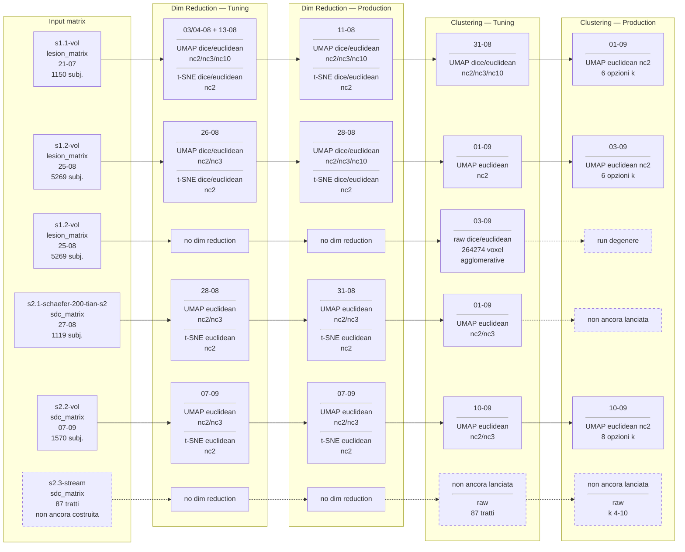
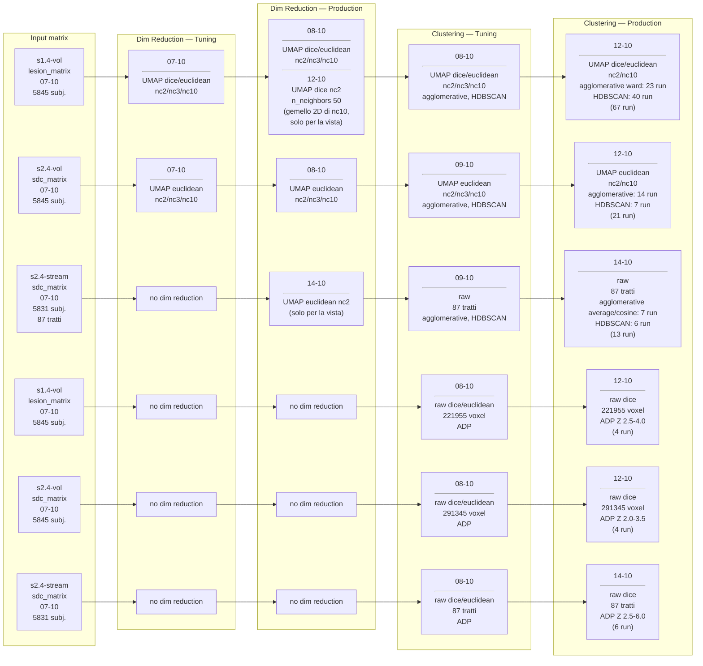

# Data Employed in Pipelines

## First Experiment Session

## Notes
The clustering that are done when the methods are not specified:

- k-means
- agglomerative
- gmm
- hdbscan
- spectral

## Second Experiment Session

## Notes
- **Produzione di clustering, 12-10 e 14-10:** 111 run. Per ogni matrice si sono prodotti i candidati "buoni" e "discreti" del tuning del 12-10 ([`clustering/s1_tuning.md`](clustering/s1_tuning.md), [`clustering/s2_tuning.md`](clustering/s2_tuning.md)); i diari sono [`clustering/s1_production.md`](clustering/s1_production.md) e [`clustering/s2_production.md`](clustering/s2_production.md).

