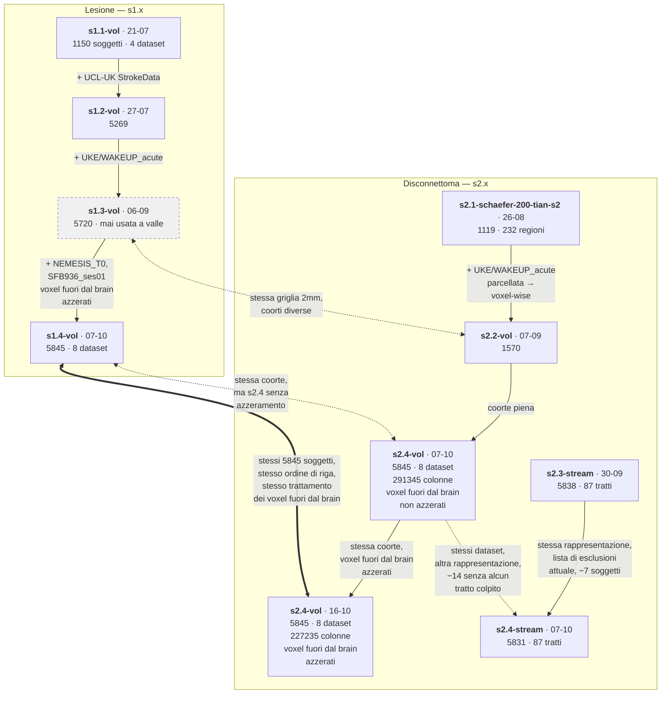

# Da quale sessione deriva quale

Le sessioni non sono indipendenti: ognuna estende una coorte precedente, e alcune sono costruite apposta per essere confrontabili tra loro. Questa pagina dice **cosa cambia da una all'altra** e **quali si possono mettere a confronto**. Il percorso di ogni sessione attraverso le pipeline è in [pipelines.md](pipelines.md), il dettaglio nel file della sessione.

## Cosa si può confrontare con cosa

- **s1.4-vol e s2.4-vol sono la stessa coorte**, lesione contro disconnettoma: stessi 8 dataset, stesso template 2mm, stessi 5845 soggetti nello stesso ordine di riga, sia per la s2.4-vol del 07-10 sia per quella del 16-10 (i `metadata.csv` delle tre matrici coincidono). È l'unica coppia su cui un confronto soggetto per soggetto è immediato; le colonne no: 221955 per la lesione, 227235 per l'SDC del 16-10.
- **Due matrici hanno il nome s2.4-vol, le distingue la data.** Quella del **07-10** ha i voxel fuori dal brain non azzerati (291345 colonne, 64110 delle quali fuori dalla maschera cerebrale) e quindi non è costruita come s1.4-vol (221955 colonne, azzerati). Quella del **16-10** è ricostruita con `correct_out_of_brain: true` (227235 colonne) ed è la vera controparte di s1.4-vol. Le due s2.4-vol hanno le stesse righe nello stesso ordine; le 227235 colonne del 16-10 sono esattamente quelle del 07-10 dentro la maschera cerebrale e i valori coincidono su di esse (verificato su 200 righe a caso), le 64110 colonne tolte esistono solo nel 07-10. Le run su di esse si confrontano per `subject_id` (vedi [s2.4-vol](s2.4-vol.md#seconda-tornata-16-10--voxel-fuori-dal-brain-azzerati)).
- **s2.4-stream** ha gli stessi dataset di s2.4-vol ma 14 soggetti in meno, quelli senza alcun tratto colpito: le righe **non** sono allineate per posizione.
- **s1.3-vol e s2.2-vol** condividono la griglia 2mm, quindi sono allineate voxel per voxel sulla griglia piena, ma le coorti sono diverse (5720 contro 1570) e le maschere di colonne non coincidono: va usato il `non_constant_mask.npy` di ciascuna, mai l'indice di colonna diretto ([s2.2-vol](s2.2-vol.md)).
- **s1.4-vol non è confrontabile voxel per voxel con le sessioni lesionali precedenti**: i voxel fuori dal brain sono stati azzerati su 1501 soggetti.
- **s2.1 e s2.2-vol** sono state costruite apposta con la stessa griglia di iperparametri, così l'unica variabile tra le due è la rappresentazione — 232 regioni contro 290940 voxel. La loro trustworthiness però **non si confronta**: ognuna misura la fedeltà al proprio spazio di input.

**s2.3-stream** ha gli stessi 8 dataset di s2.4-stream ma 7 soggetti in più (5838 contro 5831, lista di esclusioni di allora): le righe non sono allineate per posizione e le run dell'una non si riusano sull'altra.
