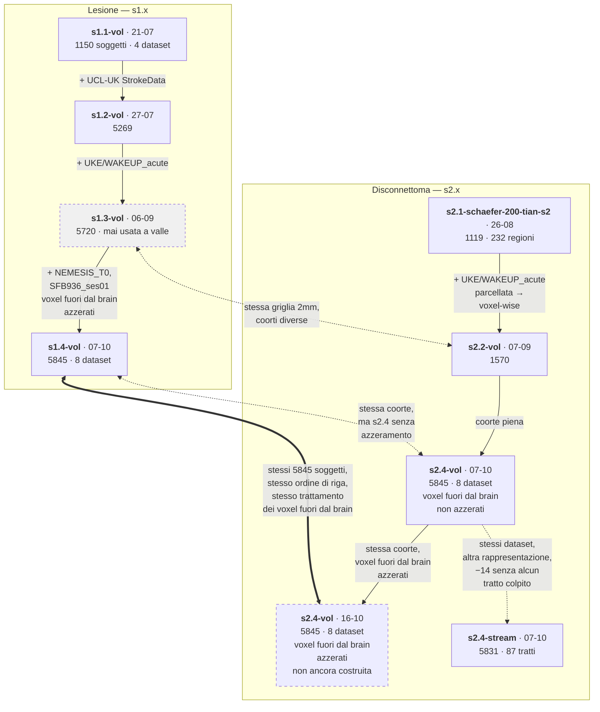

# Da quale sessione deriva quale

Le sessioni non sono indipendenti: ognuna estende una coorte precedente, e alcune sono costruite apposta per essere confrontabili tra loro. Questa pagina dice **cosa cambia da una all'altra** e **quali si possono mettere a confronto**. Il percorso di ogni sessione attraverso le pipeline è in [pipelines.md](pipelines.md), il dettaglio nel file della sessione.

## Cosa si può confrontare con cosa

- **s1.4-vol e s2.4-vol sono la stessa coorte**, lesione contro disconnettoma: stessi 8 dataset, stesso template 2mm, stessi 5845 soggetti nello stesso ordine di riga. È l'unica coppia su cui un confronto soggetto per soggetto è immediato.
- **Due matrici hanno il nome s2.4-vol, le distingue la data.** Quella del **07-10** ha i voxel fuori dal brain non azzerati (291345 colonne, 64110 delle quali fuori dalla maschera cerebrale) e quindi non è costruita come s1.4-vol (221955 colonne, azzerati). Quella del **16-10** è ricostruita con `correct_out_of_brain: true` (227235 colonne) ed è la vera controparte di s1.4-vol. Le due s2.4-vol non sono confrontabili voxel per voxel: stesse righe, colonne e valori diversi.
- **s2.4-stream** ha gli stessi dataset di s2.4-vol ma 14 soggetti in meno, quelli senza alcun tratto colpito: le righe **non** sono allineate per posizione.
- **s1.3-vol e s2.2-vol** condividono la griglia 2mm, quindi sono allineate voxel per voxel sulla griglia piena, ma le coorti sono diverse (5720 contro 1570) e le maschere di colonne non coincidono: va usato il `non_constant_mask.npy` di ciascuna, mai l'indice di colonna diretto ([s2.2-vol](s2.2-vol.md)).
- **s1.4-vol non è confrontabile voxel per voxel con le sessioni lesionali precedenti**: i voxel fuori dal brain sono stati azzerati su 1501 soggetti.
- **s2.1 e s2.2-vol** sono state costruite apposta con la stessa griglia di iperparametri, così l'unica variabile tra le due è la rappresentazione — 232 regioni contro 290940 voxel. La loro trustworthiness però **non si confronta**: ognuna misura la fedeltà al proprio spazio di input.

**s2.3-stream** non compare: era la streamline pensata quando UCL-UK non aveva ancora il CSV, e non esiste più come sessione a sé. È stata rifatta come s2.4-stream sulla lista di esclusioni attuale.
