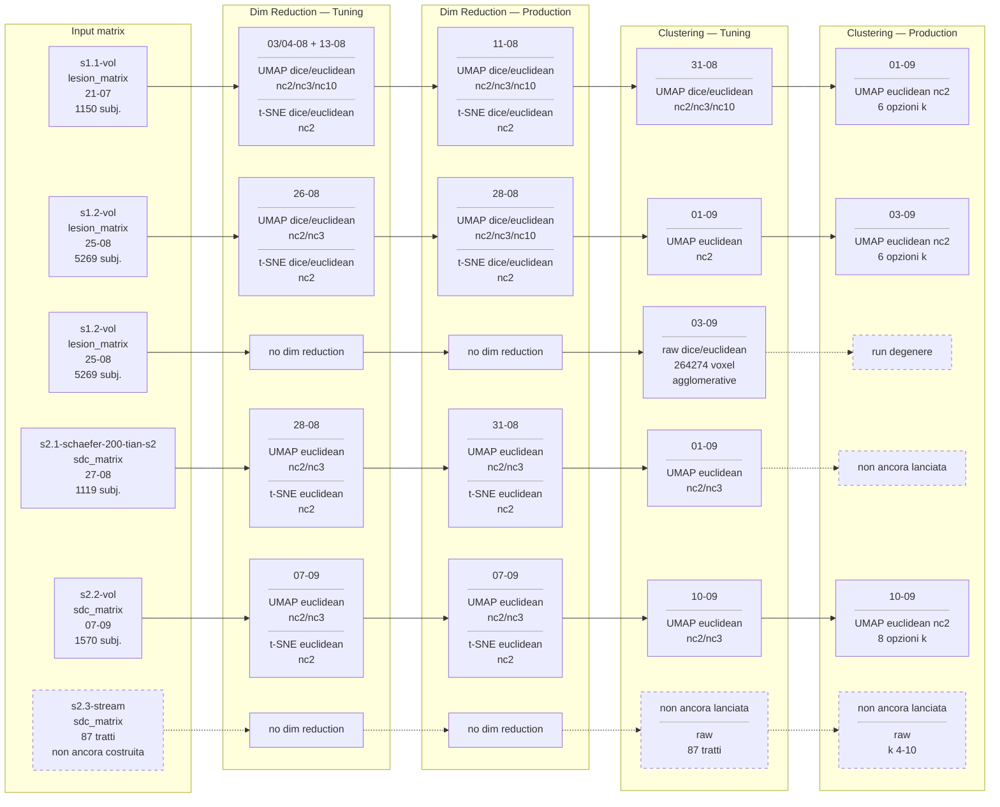
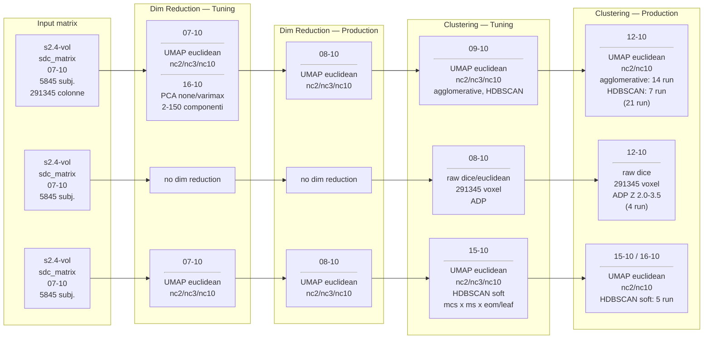
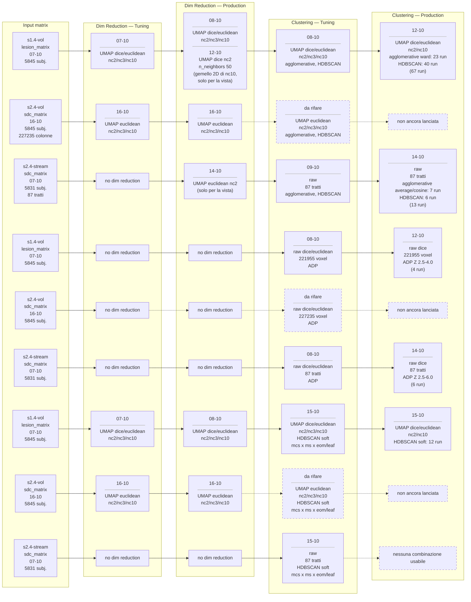

# Le pipeline attraversate da ogni matrice

Vista d'insieme delle tornate di esperimenti: dalla matrice di partenza al clustering di produzione. Il dettaglio di ogni sessione sta nel suo file, elencato nel [README](README.md).

## Prima tornata — s1.1, s1.2, s2.1, s2.2

Dove il metodo di clustering non è indicato: k-means, agglomerative, gmm, hdbscan, spectral.

## s2.4-vol del 07-10 — matrice con i voxel fuori dal brain non azzerati

Le run che si basano sulla matrice **vecchia** di s2.4-vol (291345 colonne, 64110 delle quali fuori dalla maschera cerebrale, senza `correct_out_of_brain`). Restano come storico della pipeline SDC prima della correzione; la matrice del 16-10 le rifà nella seconda tornata, qui sotto.

Tre rami per matrice: principale (UMAP, poi agglomerative e HDBSCAN), ADP sulla matrice grezza, `hdbscan_soft`. Il tuning PCA del 16-10 (`results/sdc/dim_reduction/tuning/pca`) non ha produzione né clustering in `results/`: il clustering sui 42 punteggi è un prototipo in `tmp/`, fuori dal repo ([s2.4-vol](s2.4-vol.md)).

## Seconda tornata — s1.4, s2.4

La lesione (s1.4-vol, 07-10) e le due SDC: s2.4-vol **del 16-10**, ricostruita con i voxel fuori dal brain azzerati (227235 colonne), e s2.4-stream (07-10, per tratto, non toccata dalla correzione). Le run di s2.4-vol sulla matrice vecchia del 07-10 sono nello schema precedente. I nodi tratteggiati di s2.4-vol sono da rifare: le scelte di produzione sono le stesse del 12 e del 14 ottobre, e la PCA si fa altrove.

Ogni matrice compare tre volte: il ramo principale (UMAP, poi agglomerative e HDBSCAN), il ramo ADP sulla matrice grezza, e il ramo `hdbscan_soft`. Le date dei nodi di s2.4-vol si scrivono man mano che le run esistono.
