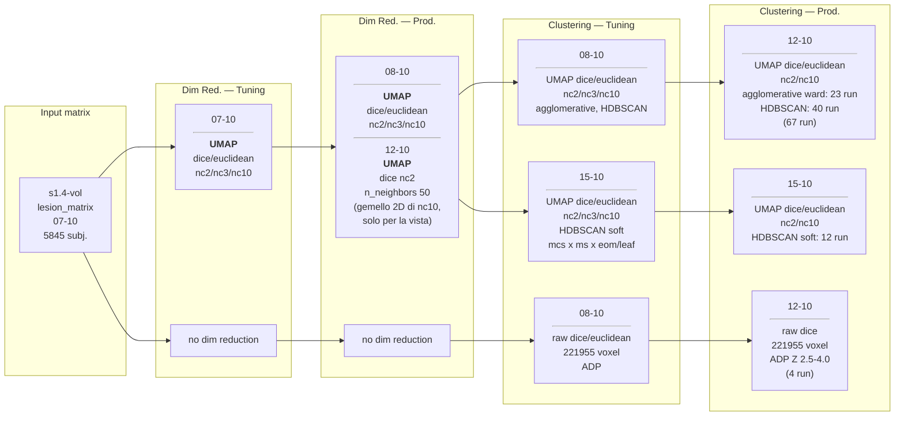
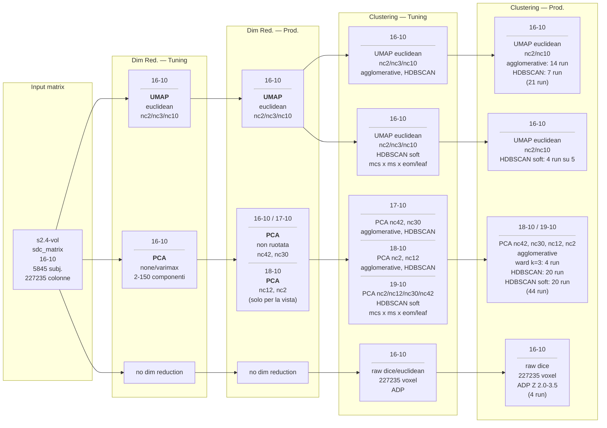
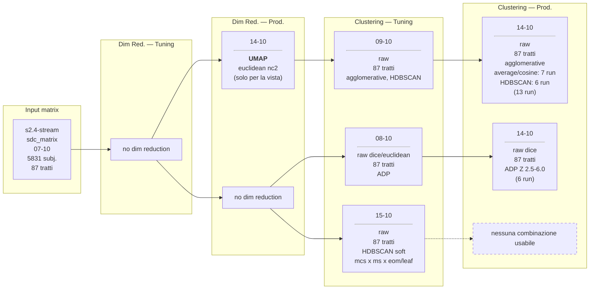
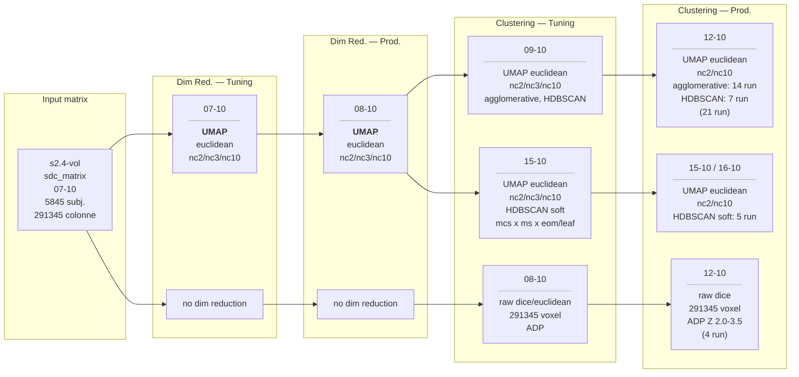
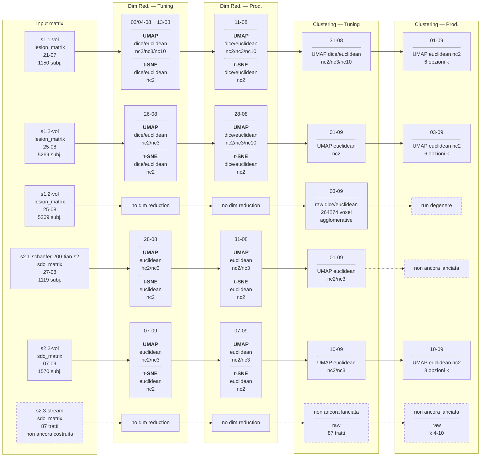

# Le pipeline attraversate da ogni matrice

Vista d'insieme delle tornate di esperimenti: dalla matrice di partenza al clustering di produzione. Il dettaglio di ogni sessione sta nel suo file, elencato nel [README](README.md).

## Seconda tornata — s1.4, s2.4

Una matrice per schema. Ogni matrice parte una volta sola e si dirama dove le pipeline divergono.

### s1.4-vol — lesione

### s2.4-vol — SDC voxelwise

Matrice **del 16-10**, ricostruita con i voxel fuori dal brain azzerati (227235 colonne). Manca una run in produzione: `hdbscan_soft` nc10, `min_cluster_size=100`, `min_samples=20`, `eom`.

### s2.4-stream — SDC per tratto

Per tratto (87), non toccata dalla correzione dei voxel fuori dal brain.

## s2.4-vol del 07-10 — storico

Matrice **vecchia**, senza `correct_out_of_brain`: 291345 colonne, 64110 delle quali fuori dalla maschera cerebrale. La ricostruisce la s2.4-vol del 16-10 (sopra). I risultati stanno in `results/legacy/sdc_s2.4-vol_07-10/`.

## Prima tornata — s1.1, s1.2, s2.1, s2.2

Dove il metodo di clustering non è indicato: k-means, agglomerative, gmm, hdbscan, spectral.
