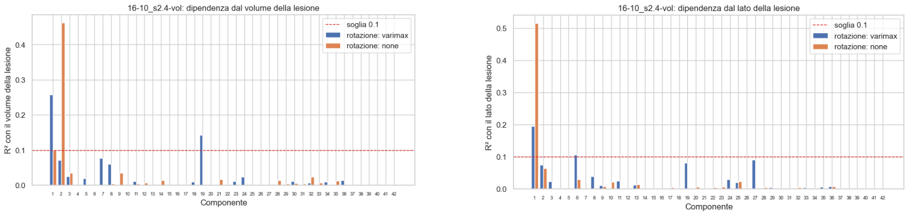

# Dimensionality Reduction

**UMAP o PCA: come riducono**

- **PCA** è lineare. Cerca le direzioni su cui i soggetti variano di più e li proietta lì.
- **UMAP** non è lineare. Costruisce il grafo dei vicini di ogni soggetto (quanti, lo decide `n_neighbors`) e cerca una disposizione a bassa dimensione che lo conservi.

La conseguenza sta nelle distanze:

- **PCA** le conserva globalmente, entro la varianza trattenuta (51% a nc2, 90% a nc42). Più componenti si tengono, più lo spazio assomiglia all'originale.
- **UMAP** conserva i vicini, cioè la struttura locale (misurata dalla trustworthiness). Le distanze tra gruppi lontani, le dimensioni e le densità dei gruppi nello spazio ridotto non hanno un significato diretto.

## UMAP

### Tuning 16-10

UMAP provato su 90 combinazioni di parametri, sulla matrice `data/derived/sdc_matrix/16-10_s2.4-vol` (5845 soggetti × 227235 voxel; i voxel fuori dal cervello sono azzerati). Durata: 22 min 39 s.

- `metric`: euclidean
- `n_components`: 2, 3, 10
- `n_neighbors`: 5, 15, 30, 50, 100
- `min_dist`: 0.0, 0.01, 0.05, 0.1, 0.5, 1.0

[config.md](../../results/sdc/dim_reduction/tuning/umap/16-10_s2.4-vol/config.md) · [tuning_results.csv](../../results/sdc/dim_reduction/tuning/umap/16-10_s2.4-vol/tuning_results.csv)

**Trustworthiness** (fedeltà ai vicini, da 0 a 1; non dice se i cluster sono giusti): 0.907-0.980 a nc2, 0.955-0.984 a nc3, 0.984-0.993 a nc10, quindi cresce con `n_components`. `min_dist` conta più di `n_neighbors`: fino a 0.1 è un plateau, da 0.5 in su cala a nc2 e nc3 e sale a nc10. A `n_neighbors=15`, `min_dist=0.0` vale 0.976, 0.984 e 0.986, a 0.004, 0.000 e 0.001 dal massimo con `min_dist` ≤ 0.1.

##### Come cambiano gli embedding

Griglie 2D: [senza colore](../../results/sdc/dim_reduction/tuning/umap/16-10_s2.4-vol/metric=euclidean/n_components=2/embeddings_grid_unico.png) · [lato](../../results/sdc/dim_reduction/tuning/umap/16-10_s2.4-vol/metric=euclidean/n_components=2/embeddings_grid_side.png) · [dataset](../../results/sdc/dim_reduction/tuning/umap/16-10_s2.4-vol/metric=euclidean/n_components=2/embeddings_grid_dataset.png) · [NIHSS](../../results/sdc/dim_reduction/tuning/umap/16-10_s2.4-vol/metric=euclidean/n_components=2/embeddings_grid_nihss.png) · [report interattivo](../../results/sdc/dim_reduction/tuning/umap/16-10_s2.4-vol/understanding_umap_euclidean.html).

**Forma della nuvola**

- `n_neighbors=5`: i punti si spezzano in frammenti staccati.
- `n_neighbors=15`: due lobi uniti da un ponte, con piccole isole sotto.
- `n_neighbors` 30-100: una V con una sola isola in alto; le isole in basso non sono più separate.
- `min_dist` ≤ 0.1: la forma non cambia.
- `min_dist` ≥ 0.5: i lobi si fondono in un'unica massa, senza ponte né isole.

**Cosa separa i punti**

- **Lato della lesione**: le sinistre a sinistra e le destre a destra, divise da una banda stretta al centro. Vale a ogni parametro.
- **Dataset**: mescolati, nessuno in una zona propria. UCL-UK, il più numeroso, copre gran parte del grafico.
- **NIHSS**: valori alti alle estremità dei due lobi, bassi al centro e sul ponte.

##### Cosa trova HDBSCAN

Su ogni embedding gira HDBSCAN (`min_samples`=10) con `min_cluster_size` 50, 75 e 100. Grigio = rumore, cioè soggetti in nessun cluster. Per nc3 e nc10 i punti sono disegnati sul gemello 2D: la disposizione è la stessa, cambiano solo i colori.

`min_cluster_size` è il numero minimo di soggetti perché un gruppo conti come cluster. Più è alto, meno cluster restano: con 50 la nuvola si spezza in chiazze, con 100 restano solo i gruppi grandi.

| n_components | `min_cluster_size` 50                                                                                                               | 75                                                                                                                             | 100                                                                                                                             |
| ------------ | ------------------------------------------------------------------------------------------------------------------------------------- | ------------------------------------------------------------------------------------------------------------------------------ | ------------------------------------------------------------------------------------------------------------------------------- |
| 2            | [2-37 cluster](../../results/sdc/dim_reduction/tuning/umap/16-10_s2.4-vol/metric=euclidean/n_components=2/hdbscan_grid_mcs50_ms10.png) | [2-25](../../results/sdc/dim_reduction/tuning/umap/16-10_s2.4-vol/metric=euclidean/n_components=2/hdbscan_grid_mcs75_ms10.png)  | [2-20](../../results/sdc/dim_reduction/tuning/umap/16-10_s2.4-vol/metric=euclidean/n_components=2/hdbscan_grid_mcs100_ms10.png)  |
| 3            | [2-31](../../results/sdc/dim_reduction/tuning/umap/16-10_s2.4-vol/metric=euclidean/n_components=3/hdbscan_grid_mcs50_ms10.png)         | [2-23](../../results/sdc/dim_reduction/tuning/umap/16-10_s2.4-vol/metric=euclidean/n_components=3/hdbscan_grid_mcs75_ms10.png)  | [2-19](../../results/sdc/dim_reduction/tuning/umap/16-10_s2.4-vol/metric=euclidean/n_components=3/hdbscan_grid_mcs100_ms10.png)  |
| 10           | [2-33](../../results/sdc/dim_reduction/tuning/umap/16-10_s2.4-vol/metric=euclidean/n_components=10/hdbscan_grid_mcs50_ms10.png)        | [2-22](../../results/sdc/dim_reduction/tuning/umap/16-10_s2.4-vol/metric=euclidean/n_components=10/hdbscan_grid_mcs75_ms10.png) | [2-17](../../results/sdc/dim_reduction/tuning/umap/16-10_s2.4-vol/metric=euclidean/n_components=10/hdbscan_grid_mcs100_ms10.png) |

- **Dove la forma resta** (`min_dist` ≤ 0.1): i cluster seguono isole e chiazze. A `n_neighbors=15`, `min_dist=0.0` sono 6-8 con rumore ≤ 0.2% in tutte e nove le griglie: un cluster prende i due lobi e il ponte, gli altri sono le isole. A `n_neighbors` 5 e 30-100, con `min_cluster_size`=50, salgono a 13-37 con rumore fino al 30%.
- **Dove la forma si perde** (`min_dist` ≥ 0.5): 2-10 cluster, una massa unica più l'isola in alto.
- **nc10 contro nc2**: a `n_neighbors=15`, `min_dist=0.5` nc10 dà 10-22 cluster con metà dei soggetti a rumore, nc2 ne dà 3-4.

##### Parametri ragionevoli

`n_neighbors=15` e `min_dist=0.0` sono una scelta ragionevole, non la migliore dimostrata: nessun indice indica una combinazione migliore, e la scelta si basa su dove la struttura si conserva e il risultato non cambia per piccole variazioni dei parametri.

- `min_dist=0.0` sta nel plateau della trustworthiness; da 0.5 in su la forma si perde.
- `n_neighbors=15` evita i due estremi: a 5 i punti si frammentano, da 30 le isole in basso si fondono.

**Cosa resta aperto**

- `n_components` si decide insieme a k, non qui.
- `min_cluster_size` dipende da quanto fini si vogliono i gruppi.
- I 6-8 cluster non sono gruppi dimostrati: sono un blocco con le isole, e in tutta la griglia il numero di cluster va da 2 a 37.

### Production

Tre embedding sulla matrice `16-10_s2.4-vol`, con i valori scelti dal tuning: `n_neighbors=15`, `min_dist=0.0`, `metric=euclidean`, `random_state=0`. Cambia solo `n_components`.

| n_components | Trustworthiness | Cartella                                                                                                                    |
| ------------ | --------------- | --------------------------------------------------------------------------------------------------------------------------- |
| 2            | 0.976           | [16-10_s2.4-vol_m_euclidean_nc2](../../results/sdc/dim_reduction/production/umap/16-10_s2.4-vol_m_euclidean_nc2/config.md)   |
| 3            | 0.984           | [16-10_s2.4-vol_m_euclidean_nc3](../../results/sdc/dim_reduction/production/umap/16-10_s2.4-vol_m_euclidean_nc3/config.md)   |
| 10           | 0.986           | [16-10_s2.4-vol_m_euclidean_nc10](../../results/sdc/dim_reduction/production/umap/16-10_s2.4-vol_m_euclidean_nc10/config.md) |

## PCA

### Tuning 16-10

PCA sulla covarianza della stessa matrice `data/derived/sdc_matrix/16-10_s2.4-vol`, senza standardizzazione. 40 combinazioni: `rotation` none e varimax × `n_components` 2, 5, 10, 15, 20, 25, 30, da 32 a 50 di 2 in 2, 75, 100, 150.

[config.md](../../results/sdc/dim_reduction/tuning/pca/16-10_s2.4-vol/config.md) · [tuning_results.csv](../../results/sdc/dim_reduction/tuning/pca/16-10_s2.4-vol/tuning_results.csv)

**Varianza cumulata**, l'unica valutazione della griglia. Non distingue le due rotazioni: le 20 righe varimax sono identiche alle 20 senza rotazione, perché il varimax ridistribuisce la varianza tra le prime *k* componenti senza cambiarne il totale.

| k        | 1     | 2     | 12    | 14    | 30    | 42    | 150   |
| -------- | ----- | ----- | ----- | ----- | ----- | ----- | ----- |
| Cumulata | 26.3% | 51.0% | 78.7% | 80.1% | 87.5% | 90.1% | 96.0% |

Il gomito è uno solo: la prima componente spiega il 26.3%, la seconda il 24.7%, la terza il 6.5%. Dopo la seconda la curva è piatta — dalla decima ogni componente sta sotto l'1.6% — quindi oltre k=2 il numero di componenti lo decide una soglia scelta a mano, non il grafico.

##### Volume e lato della lesione

R² è la quota della variabilità del punteggio di una componente spiegata dal volume della lesione, o dal suo lato: 0 vuol dire che la componente non dice niente su quella variabile, 1 che la descrive del tutto. R² 0.04 è una componente quasi indipendente dal volume, R² 0.50 una componente che misura soprattutto il volume. La linea a 0.1 è il riferimento del paper (R² < 0.1 per tutte le componenti ruotate), non una soglia nostra.

Senza rotazione i due effetti stanno nelle prime due componenti, una per ciascuno: la 1ª ha R² 0.515 col lato, la 2ª 0.462 col volume, e tutte le altre 40 restano sotto 0.04. Col varimax si spargono: nessuna componente arriva a 0.26, ma due passano 0.1 sul volume (la 1ª con 0.258 e la 19ª con 0.143) e due sul lato (0.195 e 0.107).

Prendendo le componenti insieme, in ordine di varianza:

| k  | volume (none) | lato (none) | volume (varimax) | lato (varimax) |
| -- | ------------- | ----------- | ---------------- | -------------- |
| 1  | 0.10          | 0.52        | 0.26             | 0.20           |
| 2  | 0.56          | 0.58        | 0.33             | 0.27           |
| 5  | 0.60          | 0.58        | 0.53             | 0.48           |
| 9  | 0.64          | 0.62        | 0.65             | 0.61           |
| 30 | 0.72          | 0.72        | 0.75             | 0.73           |
| 42 | 0.78          | 0.75        | 0.78             | 0.75           |

Il piano 2D della PCA non ruotata è quindi in sostanza lato × dimensione della lesione. Aggiungendo componenti l'R² sale piano e a k=42 arriva a 0.78 sul volume e 0.75 sul lato, uguale per le due rotazioni.

Entrambe le figure vengono da [pca_evaluation.ipynb](../../notebooks/post-results_analysis/pca_evaluation.ipynb) sezione 5, su questo tuning con 42 componenti.

### Production

Quattro embedding senza rotazione, con i *k* letti dalla cumulata:

| n_components | Varianza | Perché                                                                            | Cartella                                                                                           |
| ------------ | -------- | ---------------------------------------------------------------------------------- | -------------------------------------------------------------------------------------------------- |
| 2            | 51.0%    | il gomito, e la vista 2D delle run nc30 e nc42 (sono le loro prime due componenti) | [18-10_s2.4-vol_nc2](../../results/sdc/dim_reduction/production/pca/18-10_s2.4-vol_nc2/config.md)   |
| 12           | 78.7%    | appena sotto l'80%, che cadrebbe a 14                                              | [18-10_s2.4-vol_nc12](../../results/sdc/dim_reduction/production/pca/18-10_s2.4-vol_nc12/config.md) |
| 30           | 87.5%    | via di mezzo tra 12 e 42                                                           | [17-10_s2.4-vol_nc30](../../results/sdc/dim_reduction/production/pca/17-10_s2.4-vol_nc30/config.md) |
| 42           | 90.1%    | la soglia del 90%                                                                  | [16-10_s2.4-vol_nc42](../../results/sdc/dim_reduction/production/pca/16-10_s2.4-vol_nc42/config.md) |

Due con varimax, solo ai *k* bassi. Qui la procedura è diversa: il varimax ruota le prime 150 componenti (96.0% della varianza) e poi si tengono le *k* ruotate con più varianza, la maggiore per prima.

| n_components | Varianza | Cartella                                                                                                           |
| ------------ | -------- | ------------------------------------------------------------------------------------------------------------------ |
| 2            | 35.0%    | [19-10_s2.4-vol_nc2_varimax](../../results/sdc/dim_reduction/production/pca/19-10_s2.4-vol_nc2_varimax/config.md)   |
| 12           | 69.4%    | [19-10_s2.4-vol_nc12_varimax](../../results/sdc/dim_reduction/production/pca/19-10_s2.4-vol_nc12_varimax/config.md) |

Le percentuali ruotate sono più basse di quelle non ruotate a parità di *k* perché la rotazione sparge la varianza su tutte e 150 le componenti: tenendone 2 non si recuperano più le due direzioni dominanti di prima.

# Clustering

Tutte le run girano sugli embedding della sezione precedente: gli UMAP a nc2, nc3 e nc10 e le PCA a nc2, nc12, nc30, nc42, più nc2 e nc12 con varimax. 

## UMAP

### Tuning

Il clustering agglomerativo è stato provato con tre distanze: cosine, manhattan ed euclidean (`ward` solo con euclidean). Prima dei risultati, cosa misura ciascuna e perché potremmo usarla o no.

**Cosine** confronta la direzione dei vettori e ignora la loro lunghezza: si usa quando la quantità totale è un disturbo (testi di lunghezza diversa, profili genici, voti), e conta solo il profilo. **Potremmo non usarla** perché sui nostri embedding la lunghezza potrebbe portare informazione (la dimensione della lesione) e l'origine dello spazio UMAP non ha un significato, e perché non permette `ward` né Calinski-Harabasz, Davies-Bouldin e Dunn.

**Manhattan** somma le differenze lungo ogni asse, ed è più robusta agli outlier dell'euclidea: si usa con dati tabellari e con molte dimensioni. **Potremmo non usarla** perché dipende dagli assi, e gli assi di un embedding UMAP sono arbitrari: ruotare l'embedding potrebbe cambiare la partizione. Come il coseno, non permette `ward` né gli indici solo euclidei.

**Euclidean** è la distanza in linea retta: si usa con dati continui e densi, a poche dimensioni, ed è la metrica di `ward` e degli indici Calinski-Harabasz, Davies-Bouldin e Dunn. **Potremmo usarla** perché è la metrica con cui è costruito l'UMAP, non dipende dagli assi dell'embedding ed è l'unica a cui si applicano tutti gli indici. Resta sensibile agli outlier, e nei report non c'è un indice che dimostri che sia migliore delle altre.

### Production

## PCA

### Tuning

### Production
